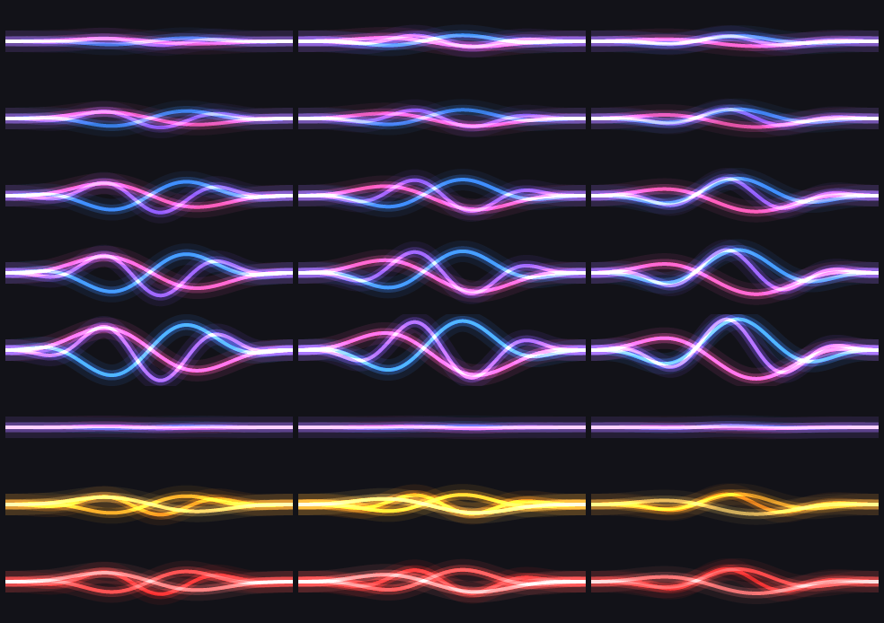

# myna-layout

`myna-layout` is a visual status indicator for [Myna](https://github.com/canonical/myna), Canonical's offline dictation app, on the COSMIC desktop running Wayland. It is for COSMIC users who want to see when Myna is loading, listening, finishing, or reporting an error.

The app observes Myna's D-Bus state and presents it in a floating bar with an audio level meter. The bar does not take keyboard focus. A desktop notification is used when the bar cannot be shown, and can also be selected on its own. `myna-layout` only observes dictation: it never starts or stops Myna and never types text.

## Requirements

- COSMIC on Wayland.
- Myna installed and running in preview. Myna is in preview, and its D-Bus interface may change; an interface change can affect compatibility with `myna-layout`.

## Wave states

The image below illustrates the audio wave states used by the indicator.



## Install

Download the `.deb` package from the [GitHub Releases](https://github.com/Joopbarbosa/myna-layout/releases) page, then install it (replace `<version>` with the package version):

```sh
sudo apt install ./myna-layout_<version>_amd64.deb
```

The indicator service starts automatically when you log in.

Or, in one command, with a clone of this repository: `./scripts/install.sh` installs the latest release package, and `./scripts/install.sh --source` builds it from the checkout first (needs Rust).

## Remove

Remove the application while keeping its configuration:

```sh
sudo apt remove myna-layout
```

To also delete the configuration directory at `~/.config/myna-layout`:

```sh
sudo apt purge myna-layout
```

## Configuration

The optional TOML file is `~/.config/myna-layout/config.toml`. If a key is omitted, its default is used. Invalid values fall back to their defaults and produce a warning.

| Key | Allowed values |
| --- | --- |
| `mode` | `"both"`, `"bar"`, or `"notification"` |
| `position.horizontal` | `"left"`, `"center"`, or `"right"` |
| `position.vertical` | `"top"`, `"center"`, or `"bottom"` |
| `position.margin` | Integer from `0` to `1000` |
| `size.width`, `size.height` | Integers from `1` to `4096` pixels |
| `meter_scale` | Number greater than `0` and at most `10` |
| `opacity` | Number from `0` to `1` |
| `reduced_motion` | `true` or `false` |

For example:

```toml
mode = "both"
meter_scale = 1.5
opacity = 0.9
reduced_motion = false

[position]
horizontal = "center"
vertical = "bottom"
margin = 24

[size]
width = 320
height = 64
```

## Troubleshooting

- If no indicator appears, check that you are in a COSMIC Wayland session and that Myna is installed and running in preview.
- If the bar is unavailable, the desktop notification is used as a substitute. You can also set `mode = "notification"` in the configuration file.
- If Myna's D-Bus interface changes, `myna-layout` may no longer recognize its states. Check the application logs and update to a compatible release when available.

## Relationship with Myna

`myna-layout` is an independent project. It contains no copied or ported Myna code. Myna is licensed under AGPL; its code and license text are not included here. This project is available under the MIT OR Apache-2.0 licenses.

## Contributing

Use a stable Rust toolchain. Before submitting changes, run:

```sh
cargo fmt
cargo clippy --all-targets -- -D warnings
cargo test
```

To build a Debian package locally, install `cargo-deb` with `cargo install cargo-deb --locked` and run `cargo deb`.

---

# myna-layout (Português)

`myna-layout` é um indicador visual de status para o [Myna](https://github.com/canonical/myna), o aplicativo de ditado offline da Canonical, no desktop COSMIC com Wayland. Ele atende quem usa COSMIC e quer ver quando o Myna está carregando, ouvindo, finalizando ou indicando um erro.

O aplicativo observa o estado do Myna pelo D-Bus e o apresenta em uma barra flutuante com medidor de nível de áudio. A barra não toma o foco do teclado. Uma notificação do sistema é usada quando a barra não pode ser exibida e também pode ser selecionada como única forma de apresentação. O `myna-layout` apenas observa o ditado: nunca inicia ou interrompe o Myna nem digita texto.

## Requisitos

- COSMIC em Wayland.
- Myna instalado e em execução no modo preview. O Myna está em preview e sua interface D-Bus pode mudar; mudanças nessa interface podem afetar a compatibilidade com o `myna-layout`.

## Estados da onda

A imagem abaixo ilustra os estados da onda de áudio usados pelo indicador.


## Instalação

Baixe o pacote `.deb` na página de [releases no GitHub](https://github.com/Joopbarbosa/myna-layout/releases) e instale-o (substitua `<versão>` pela versão do pacote):

```sh
sudo apt install ./myna-layout_<versão>_amd64.deb
```

O serviço do indicador inicia automaticamente quando você entra na sessão.

Ou em um só comando, com um clone deste repositório: `./scripts/install.sh` instala o pacote da última release, e `./scripts/install.sh --source` gera o pacote a partir do código antes (exige Rust).

## Remoção

Remova o aplicativo preservando a configuração:

```sh
sudo apt remove myna-layout
```

Para também apagar o diretório de configuração `~/.config/myna-layout`:

```sh
sudo apt purge myna-layout
```

## Configuração

O arquivo TOML opcional fica em `~/.config/myna-layout/config.toml`. Chaves omitidas usam o valor padrão. Valores inválidos voltam ao padrão correspondente e geram um aviso.

| Chave | Valores permitidos |
| --- | --- |
| `mode` | `"both"`, `"bar"` ou `"notification"` |
| `position.horizontal` | `"left"`, `"center"` ou `"right"` |
| `position.vertical` | `"top"`, `"center"` ou `"bottom"` |
| `position.margin` | Inteiro de `0` a `1000` |
| `size.width`, `size.height` | Inteiros de `1` a `4096` pixels |
| `meter_scale` | Número maior que `0` e até `10` |
| `opacity` | Número de `0` a `1` |
| `reduced_motion` | `true` ou `false` |

Exemplo:

```toml
mode = "both"
meter_scale = 1.5
opacity = 0.9
reduced_motion = false

[position]
horizontal = "center"
vertical = "bottom"
margin = 24

[size]
width = 320
height = 64
```

## Solução de problemas

- Se nenhum indicador aparecer, confira se você está em uma sessão COSMIC Wayland e se o Myna está instalado e em execução no modo preview.
- Se a barra estiver indisponível, uma notificação do sistema será usada como substituta. Também é possível definir `mode = "notification"` no arquivo de configuração.
- Se a interface D-Bus do Myna mudar, o `myna-layout` pode deixar de reconhecer os estados. Consulte os logs do aplicativo e atualize para uma versão compatível quando disponível.

## Relação com o Myna

O `myna-layout` é um projeto independente. Não contém código do Myna copiado ou portado. O Myna é licenciado sob AGPL; seu código e texto de licença não estão incluídos aqui. Este projeto está disponível sob as licenças MIT OU Apache-2.0.

## Contribuição

Use uma versão estável do Rust. Antes de enviar alterações, execute:

```sh
cargo fmt
cargo clippy --all-targets -- -D warnings
cargo test
```

Para gerar o pacote Debian localmente, instale `cargo-deb` com `cargo install cargo-deb --locked` e execute `cargo deb`.
